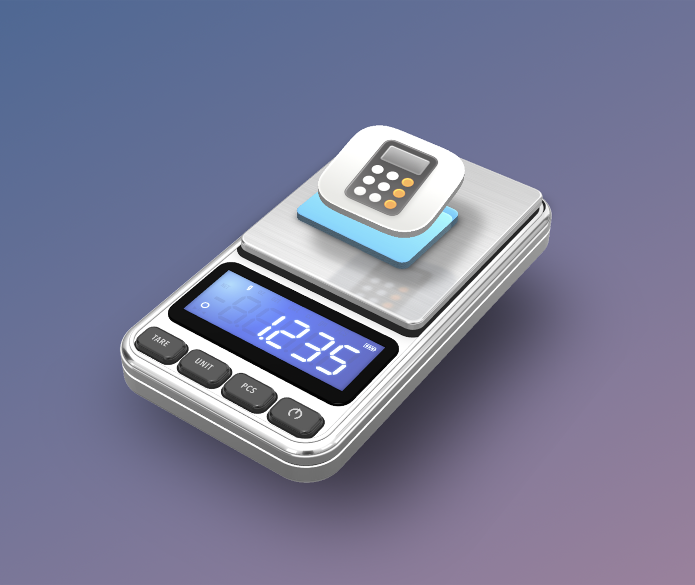

# Digital Scale

A photoreal pocket scale that floats on your Mac desktop and weighs your files.



Drag any file or folder onto the platform. It drops onto the scale as a little tile with real thickness,
a soft shadow and a reflection in the brushed steel, and the LCD shows how much it "weighs" in bytes.
There's no window around it, just the scale on your desktop.

## Download

1. Grab **Digital-Scale.zip** from the [latest release](../../releases/latest) and unzip it.
2. Move **Digital Scale.app** to your Applications folder.
3. The app isn't notarized by Apple, so the first launch needs one extra step. Right-click the app,
   choose **Open**, then confirm with **Open**. On newer macOS versions, open it once and then go to
   **System Settings → Privacy & Security → Open Anyway**.
   Or run this in Terminal: `xattr -dr com.apple.quarantine "/Applications/Digital Scale.app"`

Requires macOS 14 Sonoma or later. Runs natively on Apple Silicon and Intel.

## Using it

| Control | What it does |
|---|---|
| **⏻** | Power on/off. Like a real scale, powering on zeroes whatever is on the platform. |
| **UNIT** | Cycles B → KB → MB → GB → TB (decimal, like Finder). The last unit used is remembered. |
| **TARE** | Zeroes the current load. Removing items afterwards gives negative readings. |
| **PCS** | Piece count: the number of files on the platform (folders are counted recursively). |

- Drag a tile on the platform to move it. Drop it outside the platform to throw it away.
- Drag the scale body to move the scale around your desktop.
- Right-click for options: clear the platform, float above other windows, sounds on/off.
- Keyboard: `T` tare · `U` unit · `P` pcs · `Space`/`O` power · `⌫` clear the platform.

The display has five digits, like a real scale. A load too big for the current unit shows `-OL-`
(overload), so switch to a bigger unit.

## Building from source

You'll need the Xcode command line tools (`xcode-select --install`).

```sh
git clone https://github.com/josegoncalvespt/digital-scale.git
cd digital-scale
./build.sh
open "build/Digital Scale.app"
```

## How it's made

The app is native Swift: AppKit plus SceneKit. There are no image or sound assets; everything is
generated in code:

- **The scale** is real 3D geometry with physically based materials. The chrome gets its look from a
  procedurally painted photo-studio environment map (soft boxes, black flags, a bright floor).
- **File tiles** are built from each file's Finder icon or Quick Look thumbnail. Stacked layers give
  them thickness, and they have blurred contact shadows.
- **Planar reflections** on the satin platform come from a mirrored copy of each tile. A small Metal
  shader modifier clips it to the platform and fades it with height.
- **The load cell** is a damped spring. Readings overshoot when something lands, jitter in the last
  digit, then settle and light the stable indicator.
- **The LCD** is a seven-segment display drawn with Core Graphics, with faint unlit segments and a
  blue backlight.
- **Sounds** (piezo beeps, key clicks, the tap of a file landing) are synthesized with AVFoundation.

To render an offscreen picture of the scene while tweaking the look:
`DigitalScale --snapshot out.png [files…] [--hover]`

## License

MIT
